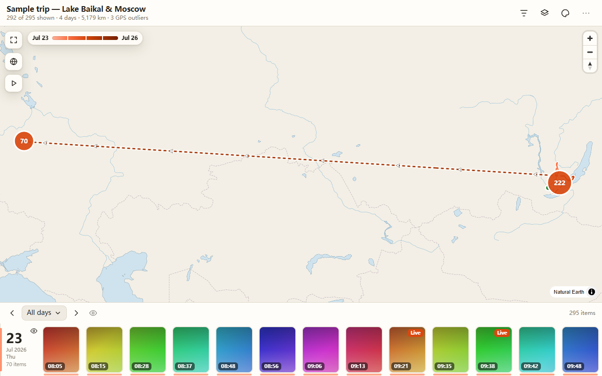

# Photo Way

[简体中文](README.zh-CN.md) · [English user guide](docs/USER_GUIDE.md) · [中文使用指南](docs/USER_GUIDE.zh-CN.md)

Turn a pile of geotagged phone photos into a **portable route map**: one `.html` file
(or a small zip) that opens by double-click, works offline, and can be shared without the app.



Photo Way is a small desktop app for Windows and macOS, plus a `photoway` command line tool.
You drop in photos and videos from your phone, check the preview, and export. Everything
runs on your computer; nothing is uploaded.

The screenshots use a synthetic sample trip.

## Download

Get the latest version from the
[Releases page](https://github.com/JohnnnyTang/photo-way/releases/latest).

| You use | Download |
|---|---|
| Windows | the NSIS installer (`.exe`) or the `.msi`; from v0.2.0, choose an English or Simplified Chinese MSI |
| macOS (Apple silicon and Intel) | the universal `.dmg` |
| Command line only | `photoway-cli-<version>-windows-x64.zip` or `photoway-cli-<version>-macos-universal.tar.gz` |

Each release also has `SHA256SUMS.txt`, `THIRD_PARTY_NOTICES.md`, `licenses.zip`, and
`third-party-sources-<version>.tar.gz` (the libheif and libde265 source, see [Licence](#licence)).

The installers are **not code-signed yet**. Windows SmartScreen and macOS Gatekeeper will warn the
first time; [the user guide](docs/USER_GUIDE.md#installing) shows how to open the app anyway.

## Quick start

**App.** Open Photo Way, drop a folder of photos (or click *Add photos...* / *Add folder...*),
click *Build preview*, then *Export...* and pick a format. Open the result in your browser from the
export panel. Step by step: [docs/USER_GUIDE.md](docs/USER_GUIDE.md).

**Command line.**

```sh
photoway inspect ~/Photos/trip                      # what would be found, and what is skipped
photoway build ~/Photos/trip -o trip.html           # one self-contained file
photoway build ~/Photos/trip -o trip.zip --format zip --full web
photoway serve trip.zip                             # http://127.0.0.1:8765, no unzipping needed
```

`build` takes `--title`, `--full none|web|original`, `--web-edge`, `--no-video`, `--keep-exif`,
`--coord-decimals`, `--theme`, `--basemap`, `--cache` and `--format html|dir|zip`.
All options are listed in the [CLI reference](docs/USER_GUIDE.md#command-line-reference).

## What you get

- A route on a map with direction arrows, start and end markers, and clustered photo pins that
  turn into thumbnails as you zoom in.
- A timeline with day navigation, distance, climb and time for each day and the whole trip, a photo and
  video viewer, Live Photo and video support.
- Basemaps: an offline world map that always works, plus satellite, topographic, street and
  **3D terrain** when you are online. Themes: auto, light, dark, dusk, paper, forest.
- GPS glitch filter, drag-a-pin to fix a wrong location, hide items, export your corrections, and
  *Save a copy* of the single HTML file with your edits built in.
- Exports open from `file://` and from any web server, in Chrome, Edge, Firefox and Safari,
  on phones too.
- Privacy options at export time: strip EXIF, round coordinates, thumbnails only, or
  web-size / original photos.

## Privacy

Photo Way reads your files locally and writes the export where you tell it to. It does not upload
anything. **The map you export shows where the photos were taken**, which can reveal your home,
workplace or daily routine. Read
[Sharing and privacy](docs/USER_GUIDE.md#sharing-and-privacy) before you send it to anyone.
The online basemaps load tiles from third-party servers when the viewer is open and online;
the offline world map does not.

## Documentation

- [User guide](docs/USER_GUIDE.md): install, get originals with location off your phone, use the app and the map, troubleshooting.
- [Building from source](docs/BUILDING.md)
- [Architecture](docs/ARCHITECTURE.md) and [data format](docs/DATA_CONTRACT.md)
- [Changelog](CHANGELOG.md)
- [The old macOS export script](legacy/README.md) (optional helper)

## Development

Needs Rust (stable), Node.js and a C/C++ toolchain; the full setup, including HEIC support, is in
[docs/BUILDING.md](docs/BUILDING.md).

```sh
npm ci
npm run fixtures           # synthetic sample data in fixtures/sample/
npm run build -w viewer    # viewer/dist
cargo test --workspace
```

| Path | What |
|---|---|
| `crates/core` | Rust core: scan, metadata, media, bundle writer, local server |
| `crates/cli` | `photoway` command line tool |
| `app/` | Tauri 2 desktop app |
| `viewer/` | The exported map viewer (TypeScript + MapLibre) |
| `schema/`, `docs/DATA_CONTRACT.md` | Project data format |
| `legacy/` | The original macOS export script and Cesium generator (reference) |

`node scripts/screenshots.mjs` regenerates the images in `docs/img/`.

## Licence

MIT, see [LICENSE](LICENSE). HEIC decoding uses libheif and libde265 (LGPL-3.0), linked statically;
notices are in [THIRD_PARTY_NOTICES.md](THIRD_PARTY_NOTICES.md), and
[docs/BUILDING.md](docs/BUILDING.md#rebuild-with-modified-lgpl-libraries) explains how to rebuild
with modified versions.
