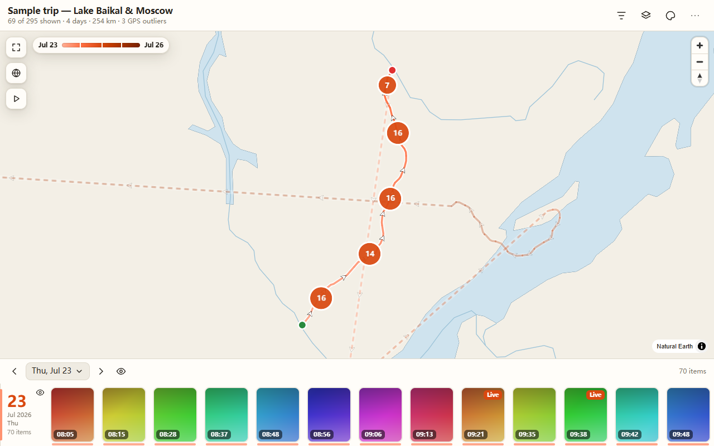

# Photo Way user guide

Photo Way turns photos and videos that carry a GPS location into a route map you can open in any browser.
This guide covers installing, getting the right files off your phone, using the app and the exported map,
sharing safely, the command line, and fixing problems.

- [Installing](#installing)
- [Getting originals with location off your phone](#getting-originals-with-location-off-your-phone)
- [Using the app](#using-the-app)
- [Using the exported map](#using-the-exported-map)
- [Sharing and privacy](#sharing-and-privacy)
- [Command line reference](#command-line-reference)
- [Troubleshooting](#troubleshooting)



## Installing

Download the installer for your system from the
[latest release](https://github.com/JohnnnyTang/photo-way/releases/latest):

- **Windows:** the `.exe` installer (NSIS) or the `.msi`.
- **macOS:** the universal `.dmg`, which runs on Apple silicon and Intel Macs. Open it and drag Photo Way to Applications.

`SHA256SUMS.txt` on the release page lets you check that a download is intact
(`certutil -hashfile <file> SHA256` on Windows, `shasum -a 256 <file>` on macOS).

The installers are **not code-signed yet**, so your system warns you the first time. This is expected.

**Windows.** SmartScreen shows "Windows protected your PC". Click **More info**, then **Run anyway**.

**macOS.** Gatekeeper says the app cannot be verified. Either:

1. Right-click (or Control-click) Photo Way in Applications, choose **Open**, then **Open** again in the dialog; or
2. On newer macOS versions, where that dialog has no Open button: try to open the app once, then go to
   **System Settings, Privacy & Security**, scroll to the Security section, and click **Open Anyway** next to the
   message about Photo Way. Confirm with your password.

You only need to do this once.

## Getting originals with location off your phone

Photo Way reads the location stored inside each file. Many ways of moving photos strip it, and the app
cannot add it back. Use one of these.

### iPhone

- **AirDrop to a Mac.** In the Photos app select the photos, tap Share, then **Options** at the top of the sheet
  and turn on **All Photos Data** (this keeps location and sends the unedited originals). Then AirDrop.
- **Photos on a Mac** (with iCloud Photos or after importing). Select the photos, then
  **File, Export, Export Unmodified Original**. A plain "Export photos" can change the format and metadata.
  For a date range there is also the [optional helper script](../legacy/README.md).
- **Windows.** Plug the iPhone in with a cable, tap Trust, and import with the Windows Photos app, or copy the
  files from the iPhone's `DCIM` folder in File Explorer. Copying from `DCIM` keeps location.
- **Not recommended:** the Share sheet to Messages, Mail or most apps. In Options there is a **Location**
  toggle; if it is off, or the app re-encodes the photo, the location is gone. iOS also lets you turn
  location off per share, so check that toggle.

Videos from the iPhone Camera carry location too, but only if Location Services for the Camera were on when recording.

### Android

- **Copy over USB.** Connect the phone, choose File transfer, and copy the `DCIM/Camera` folder. This keeps
  everything the camera wrote. This is the most reliable way.
- **Google Photos downloads and shares** may remove location, depending on how you share. A link share has a
  setting for hiding location, and some download paths re-encode the file. If `photoway inspect` reports
  "no location" for photos you know were geotagged, switch to the USB copy.
- **Google Takeout** keeps the location in a separate `.json` file next to each photo, and the photo itself
  may no longer contain it. Photo Way does not read those JSON files yet.
- Phones only record location if the camera app's location tag setting was on when you took the photo.

### Check before you export

Drop the folder into Photo Way, or run `photoway inspect <folder>`. The app reports how many items have a
location and lists the skipped files by reason.

## Using the app

1. **Add files.** Drop photos, videos or folders onto the window, or use **Add photos...** and **Add folder...**.
   You can add more at any time. **Start over** clears everything. Supported: JPEG, HEIC/HEIF, PNG, TIFF, DNG,
   and MOV, MP4 videos.
2. **Read the summary.** Under **Found** you see how many items have a location out of how many files,
   the number of photos, videos and Live Photos, and the date range. If files were skipped, the
   "files skipped" line expands to list them by reason: no location, unreadable, unsupported, or duplicate.
3. **Set the options** (below).
4. **Build preview.** The app prepares thumbnails and previews, then shows the real map in the window.
   If you change a media option afterwards, the app says "Media options changed. Rebuild to apply them." and the
   button becomes **Rebuild preview**. Repeat exports of the same photos are fast because rendered media is cached.
5. **Export...** Choose a format, click **Export**, and pick where to save. Cancel is available while it runs.
6. **After export**, **Open in browser** opens the result, **Reveal** shows it in Explorer or Finder, and **Serve**
   hosts it on a local address (**Stop serving** ends that).

### Options

| Option | What it does |
|---|---|
| Title | Shown at the top of the map. |
| Full-size photos | **None (thumbnails only)** keeps the export small; viewers can only see small preview images. **Web size** adds a resized copy of each photo (set the long edge under **Web size, long edge**, 1280 to 4096 px; 2048 is the default). **Original files** copies the originals, which is large but lossless. |
| Include videos | Adds the videos (and Live Photo motion clips) to the export. Off keeps only their still previews. |
| Strip EXIF metadata | Removes camera and location metadata from image files in the export. On by default. Thumbnails and web-size photos never carry it; the switch matters when you choose original files. |
| Coordinate precision | **Full (exact)**, or round coordinates to 6, 5, 4, 3 or 2 decimals (about 0.1 m, 1 m, 10 m, 100 m, 1 km). Rounding is applied to the exported map data, so the map no longer holds the exact position. |
| Default basemap | Which map style the viewer opens with: Automatic, Offline world, Satellite, Satellite with labels, Topographic, OpenStreetMap, or Terrain. Viewers can still change it. |
| Default theme | Automatic, Light, Dark, Dusk, Paper or Forest. Viewers can still change it. |

### Choosing an export format

| Format | Best for | Notes |
|---|---|---|
| **Single HTML file** | Sending by chat or email; a few hundred photos | One file with everything inside. Thumbnails are embedded, so the file grows with the photo count. Supports **Save a copy**. |
| **Folder** | Large trips, full-size photos, putting on a web server | `index.html` with its assets next to it. Open `index.html`. |
| **Zip** | Sending a folder as one file | Tell the receiver to unzip it first, then double-click `index.html`. The zip contains a `README.txt` saying so. |

The app shows a size estimate before you export. If a single HTML would be above 50 MB it warns that
the file "can be slow to open" and suggests a folder or zip. Full-size photos are a good reason to prefer a folder or zip.

## Using the exported map

Open the `.html` file (or the folder's `index.html`) by double-click. No install or server is needed.
It works in current Chrome, Edge, Firefox and Safari, including on phones.

### Map

- The route is drawn in trip order with direction arrows; the first item is marked "Start" and the last "End".
- Pins cluster into numbered circles. Zoom in to see photo thumbnails ("Zoom in to see photos" appears when you are far out).
  Click a pin to see its card; **Open** shows the photo or video.
- **Fit all** frames the whole trip. The **Globe** button switches between globe and **Flat map** projection.
- The play button (**Play the trip**) steps through the stops; click the speed to cycle 1x to 8x.

### Map styles (the layers button, "Map")

- **Offline world** always works, with no internet.
- **Satellite**, **Satellite + labels**, **Topographic** and **Street map** load tiles online.
- **3D terrain** shows relief with hillshade; tilt and rotate the map, and use
  **Terrain exaggeration** to scale the heights. It needs internet.
- If online tiles cannot load, the map falls back to the offline map and says so.

### Themes

The "Theme" button offers **Auto** (follows your system), **Light**, **Dark**, **Dusk**, **Paper**
and **Forest**. Your choice is remembered per viewer in the browser.

### Timeline and days

The strip at the bottom is the timeline. Click a thumbnail to locate it on the map, double-click to open it.
The day selector ("All days", **Previous day**, **Next day**, or **Choose a day**) shows one day at a time;
the eye button next to a day shows or hides every item of that day. Days are grouped by local time at the
place the photo was taken, so a trip across time zones keeps the right dates.

Each day in the day list shows how far you travelled that day, how much you climbed and descended, and how long
the day lasted, for example "42.3 km · ↑ 610 m ↓ 580 m · 7 h 12 min". The line under the title shows the same
for the whole trip, or for the day you have chosen. Distance follows the route; the jump from one day to the
next counts only in the trip total. Elevation needs at least two photos with an altitude in that day, and
changes under 10 m are ignored because phone altitudes are noisy. Hiding items, turning the GPS outlier filter
on or off, or fixing a position updates the numbers straight away.

### Filters ("Filters", Show on map)

- **Type:** All, Photos, Videos, Live.
- **Route:** show or hide the route line.
- **Hide GPS outliers:** hides items that would need more than 300 km/h to reach from their neighbours,
  usually bad GPS fixes. They stay in the timeline marked "Suspect GPS position". Turn it off to see them.
- **Trip order**, each a switch: **Color by time** (light at the first photo, dark at the last, with a legend),
  **Number the stops**, and **Highlight on hover** (pointing at a photo lights up its part of the route).

### Fixing and hiding items

- **Drag to correct.** Click a pin to open its card and drag the pin to the right place. "Corrected" is shown on
  the card, and **Reset position** undoes it.
- **Hide** removes an item from the map without deleting it. Use the card's **Hide** button or the
  checkbox on the item in the timeline.
- Both edits are stored in your browser, per map (each export has its own id), not in the file.
  Edits made in Chrome are not visible in Firefox or on another computer, and clearing site data removes them.

The **More** menu has:

- **Export corrections** downloads your location fixes and hidden items as JSON.
- **Save a copy** downloads the page with your edits built in. Choose whether to **Keep hidden items in the copy**
  and click **Download copy**. This is only available in the single-file version; a folder or zip shows
  "Saving a copy needs the single-file version of this page."
- **Discard all edits** resets everything stored in this browser.

If the browser blocks storage, the viewer warns that edits will not survive a reload; use
**Export corrections** or **Save a copy** in that case.

## Sharing and privacy

**A route map shows where you were.** Before you send one:

- Photos near your home, workplace or a child's school reveal those places, especially in a map with
  a satellite view. Remove those photos (leave them out of the folder you drop in) or hide them
  in the viewer and use **Save a copy** with hidden items **not** kept.
- Use **Coordinate precision** to blur positions. 2 decimals is about 1 km, 3 about 100 m.
- Leave **Strip EXIF metadata** on, and avoid **Original files** unless you want the receiver to
  have the exact originals with all their data.
- A single HTML file contains the thumbnails and coordinates; anyone with the file has them. Treat it like the photos themselves.
- Photo Way sends nothing anywhere. The exported map itself loads map tiles from online servers
  (Esri, OpenStreetMap, OpenTopoMap, AWS terrain) when you pick an online style; the tile servers can see which area
  you look at. The **Offline world** style loads nothing.
- Corrections in the viewer are visible in your browser to other pages on the same computer
  (see the note in the **More** menu); they are not sent anywhere.

## Command line reference

The `photoway` CLI uses the same core as the app. Download it from the release page (CLI archive) or use the
copy built with the app.

```
photoway build <INPUTS>... -o <OUT> [options]
photoway serve <PATH> [--addr HOST:PORT]
photoway inspect <INPUTS>... [--json]
```

`<INPUTS>` are photo files or folders. Run `photoway --help` or `photoway <command> --help` for the full text.

### build

| Flag | Meaning | Default |
|---|---|---|
| `-o, --out <PATH>` | Output: a `.html` file, a folder, or a `.zip` | required |
| `--format html\|dir\|zip` | Output format | `html` |
| `--title <TEXT>` | Map title | `Photo Way` |
| `--full none\|web\|original` | Full-size media next to thumbnails | `web` |
| `--web-edge <PX>` | Long edge for `--full web` (1280 to 4096) | `2048` |
| `--no-video` | Leave out videos and Live Photo motion clips | off |
| `--keep-exif` | Keep EXIF in images copied with `--full original` | off (EXIF is stripped) |
| `--coord-decimals <N>` | Round coordinates to N decimals | exact |
| `--cache <DIR>` | Cache rendered media so re-exports are fast | none |
| `--theme <NAME>` | `auto`, `light`, `dark`, `dusk`, `paper`, `forest` | `auto` |
| `--basemap <NAME>` | `auto`, `offline`, `satellite`, `satellite-labels`, `topo`, `osm`, `terrain` | `auto` |

Progress goes to stderr. On success it prints the item counts, the skipped count and the output path and size.

### serve

Serves a folder, a zip (without extracting it), or a single HTML file at `127.0.0.1:8765` by default.
The first line printed is `Serving <path> at <url>`. Use `--addr 127.0.0.1:0` to pick a free port.

### inspect

Prints one line per usable file (kind, time, coordinates, path), then the skipped files with a reason
(`no-location`, `unreadable`, `unsupported`, `duplicate`) and a count. `--json` prints the same as JSON.

### Examples

```sh
photoway inspect ~/Pictures/iphone-trip
photoway build ~/Pictures/iphone-trip -o trip.html --title "Iceland 2026" --coord-decimals 3
photoway build ~/Pictures/iphone-trip -o trip.zip --format zip --full original --cache ~/.cache/photoway
photoway build ~/Pictures/iphone-trip -o trip-dir --format dir --theme dark --basemap offline
photoway serve trip-dir
```

## Troubleshooting

**"No geotagged photos or videos found."** The files have no location. See
[Getting originals with location](#getting-originals-with-location-off-your-phone). Run `photoway inspect`
to see the skip reason per file. The camera's location setting may also have been off.

**Some files show as skipped.** The summary groups them: no location, unreadable (damaged or unsupported
contents), unsupported type, or duplicate (the same file added twice).

**A video does not play.** iPhone videos are often HEVC (H.265). Chrome and Firefox play HEVC only when the
operating system and hardware support it, and Firefox on some systems cannot at all. Try Safari or Edge, or
convert the video to H.264. The map still shows a preview image, and when the video file is not part of the
export the viewer says "The video file is not part of this export. Showing its preview image."
In the app, videos the webview cannot decode use a placeholder poster.

**"Preview image only - full size is not included in this export."** You exported with **Full-size photos**
set to **None**. Export again with **Web size** or **Original files**.

**The file is huge or slow to open.** Single HTML files embed thumbnails; above about 50 MB use **Folder**
or **Zip**. Turn off **Include videos**, or lower the web size, to shrink an export.

**The map is blank or says it needs WebGL 2.** The viewer needs WebGL 2. Update your browser or enable
hardware acceleration. The timeline still works without the map.

**Online map styles do not load.** You are offline or the tile server is unreachable. The viewer falls back to the
**Offline world** map. The 3D terrain style needs a connection.

**The zip opens as a blank page.** Unzip it first, then open `index.html`. Do not open the page from inside the zip viewer.

**My edits are gone.** Edits are saved in the browser that made them, for that map. Use **Export corrections** or
**Save a copy** to keep them elsewhere.

**Windows or macOS refuses to open the app.** See [Installing](#installing).
