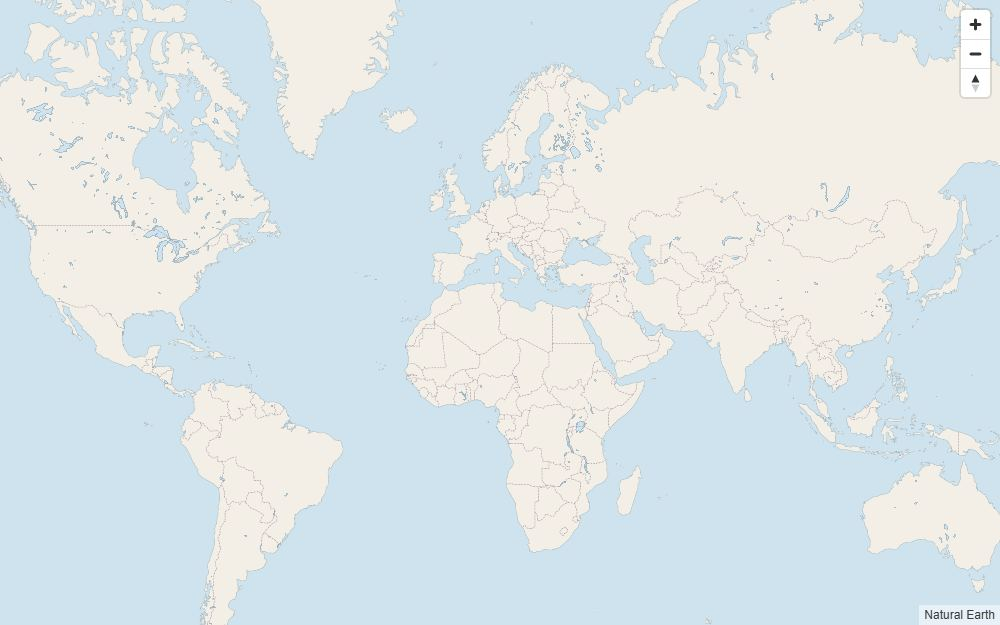
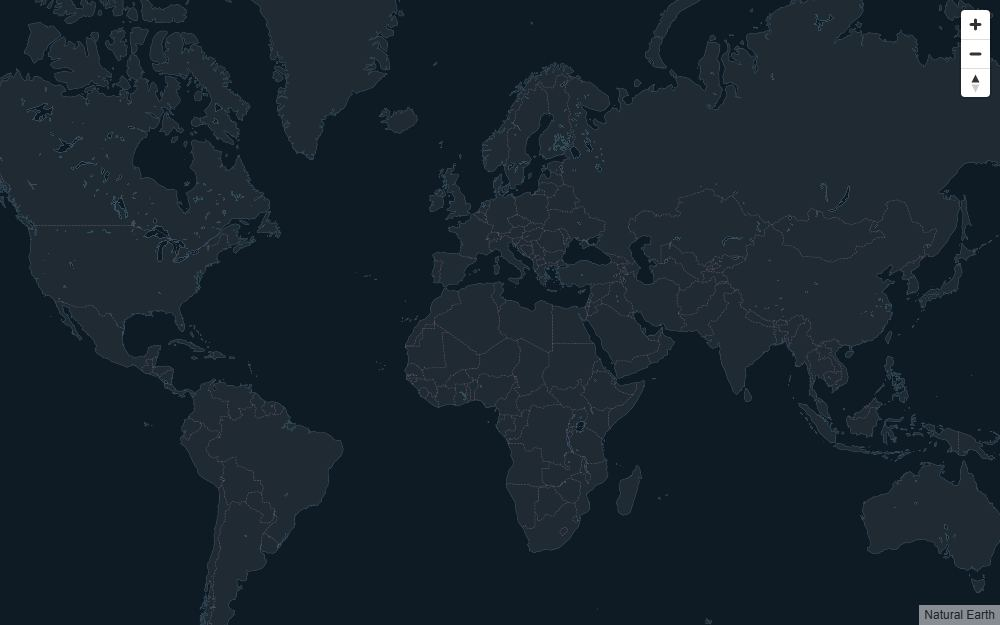
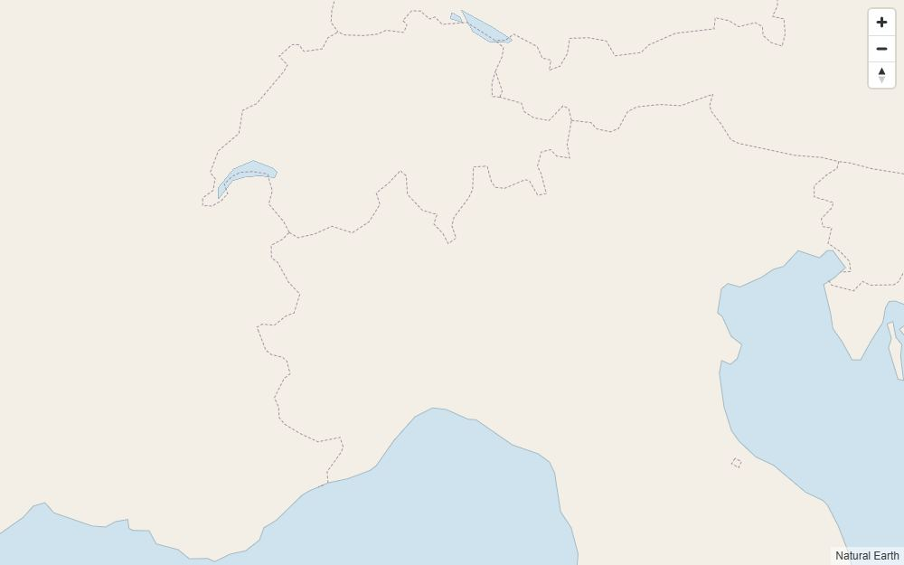
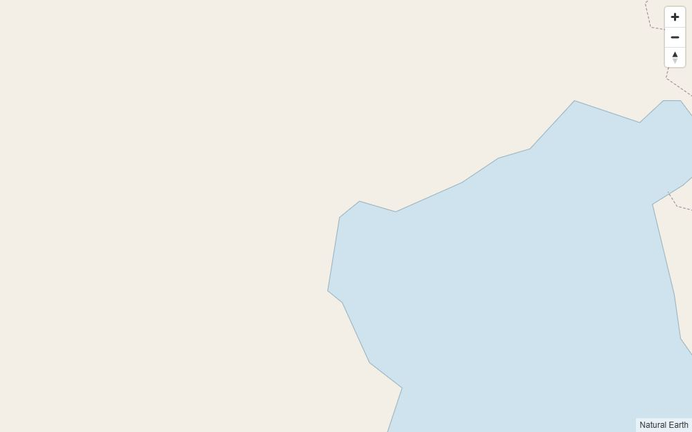
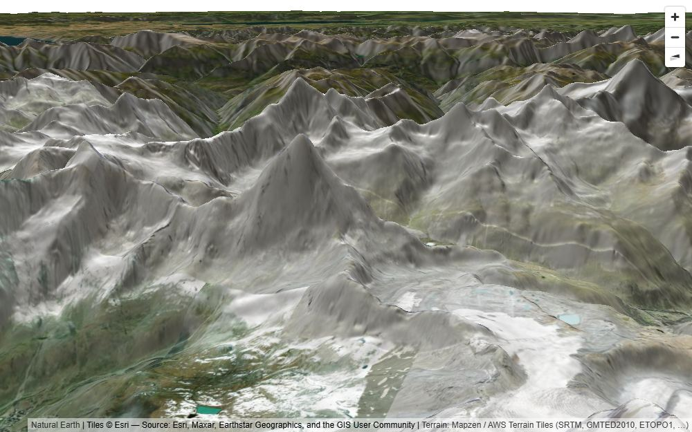
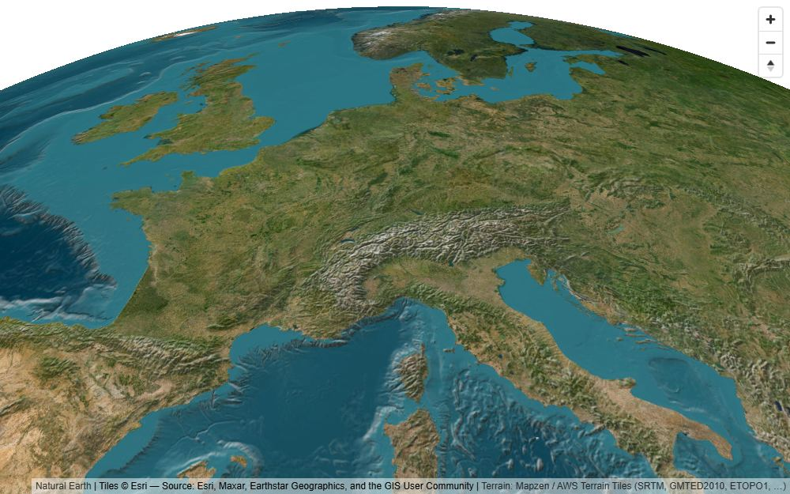
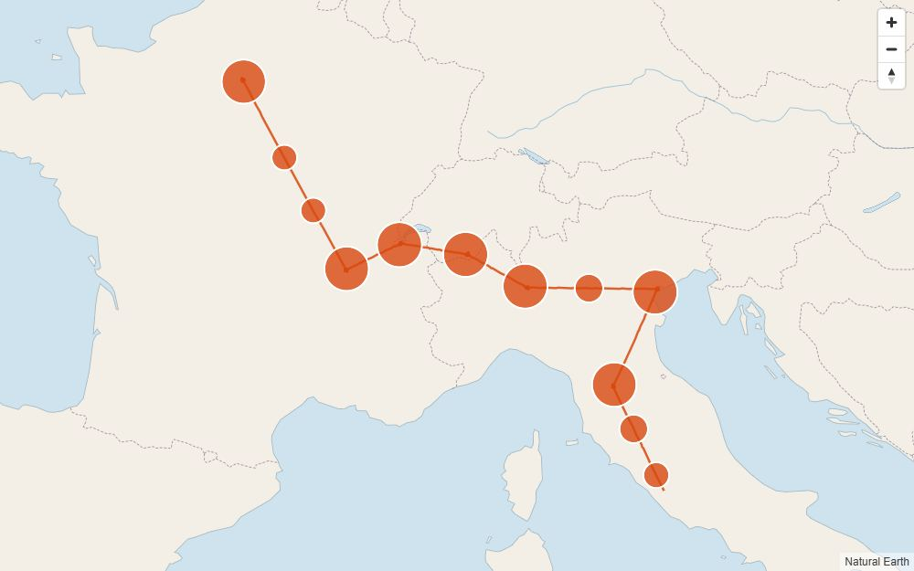
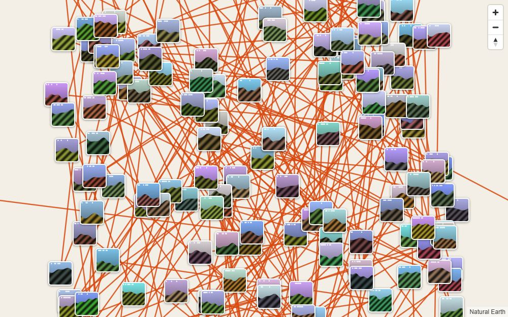

# Spike S2: file:// viewer feasibility

> Branch `spike/file-protocol` · 2026-10-24 · Windows 11, Node 24.12, Playwright 1.64.1 (headless)
> Code: `spikes/file-protocol/` (throwaway, only on branch [`spike/file-protocol`](https://github.com/JohnnnyTang/photo-way/tree/spike/file-protocol)) and `viewer/basemap/build.mjs` (adopted into main).
> Units: KiB = 1024 bytes; "gz" = `gzip -9`.

## TL;DR

| # | Question | Verdict |
|---|---|---|
| 1 | MapLibre GL JS 6.15 inlined as a classic script, from `file://` and HTTP | **Yes, but not out of the box.** v6 ships only as ESM, so Vite has to bundle it into the IIFE. Its default *module* worker started from a `blob:` URL **fails on file:// in Chromium/Chrome/Edge and WebKit** (it works in Firefox and works everywhere over HTTP). What works everywhere: inline the worker source, strip its trailing `export{…}` at build time, and call `setWorkerUrl(blobUrl + "#maplibre-gl-worker.cjs")`, which gives a *classic* blob worker. Pin **`maplibre-gl@6.15.0` exactly**. Cost: v6 is **+550 KiB raw / +160 KiB gz** compared with v5, because the worker duplicates the shared code. That breaks the PLAN §2.1 viewer budget. Plan B is `maplibre-gl@5.24.0` (UMD), which works unmodified everywhere. |
| 2 | Offline Natural Earth basemap ≤ 600 KB | **Yes.** It's 50m land, lakes, borders and rivers, simplified to 3 km and stored as TopoJSON (q=1e5): **580.8 KiB** raw / 189.5 KiB gz. The same data as GeoJSON is 1,021 KiB, so TopoJSON wins (decoder: 7 KiB). It looks good at z0–6 and coarse/angular at z7–8. No tile, glyph or sprite requests. |
| 3 | Online raster, 3D terrain (AWS Terrarium), hillshade, globe from `file://` | **Yes, in all engines.** Esri, OSM and S3 Terrarium all answer `Access-Control-Allow-Origin: *` to `Origin: null`. The DEM pixels are readable: `queryTerrainElevation(Matterhorn)` returns 5,984 m, which is 4,274 m × 1.4 exaggeration. Globe works, and globe + terrain works. |
| 4 | 2,000 lazy thumbnails from a base64 pack in one HTML | **Yes.** The file is **34.5 MiB**. First render takes 0.66 s in Chromium, 0.92 s in Firefox and 1.05 s in WebKit (empty shell: 0.45 s). Chromium memory goes up by **+36 MB** working set with the pack loaded and +37 MB more with 134 thumbnail markers. JS heap stays at 7 → 9 MB. Each thumbnail is decoded from its own base64 slice in about 0.3 ms. |
| 5 | localStorage on `file://` | **It persists** across reloads and browser restarts in every engine. It is **shared by every local HTML file**, in any folder, in Chromium, Chrome, Edge, Playwright-Firefox and Playwright-WebKit. Keys must be namespaced by `project.id`, as the contract already does. See §5 for the extra rules this implies. |
| 6 | "Save a copy" (self-re-serialisation) | **Yes, in all engines and over both file:// and HTTP.** The download works with a click and also without a gesture (Playwright). The 34 MiB copy serialises in 66–192 ms and re-opens with working thumbnails. There's a contract problem with ids, though (§10). |

Tested engines (all of them over both file:// and `http://127.0.0.1:8765`): Playwright Chromium 156.0.8078.4, installed **Google Chrome 155.0.8059.86** and **Microsoft Edge 156.0.4314.42**, Playwright Firefox 157.0 and Playwright WebKit 27.2 (the Windows build, *not* Safari).

---

## 1. MapLibre GL JS 6.15 as an inline classic script

### What changed in v6
- 6.0.0: *"Switch to an ESM-only distribution… The UMD bundles (`maplibre-gl.js`, `maplibre-gl-csp.js`) are no longer published… the ESM build loads its worker as a real URL"*. The package now has only `dist/maplibre-gl.mjs` (main, which uses `import.meta.url` and `export {…}`) and `dist/maplibre-gl-worker.mjs`, a separate, self-contained ES module ending in `export{dC as default}`.
- 6.13.0: the worker became self-contained again. `maplibre-gl-shared.mjs` is now an empty file. As a result the shared code ships twice, in the main bundle and in the worker.
- Worker creation (6.15.0 `dist/maplibre-gl.mjs`) works like this. `url = config.WORKER_URL || autoDetect(import.meta.url)`, where auto-detect only works for `http(s):` module URLs. MapLibre starts a **module** worker unless the URL ends in `.cjs`. If `new URL(url).origin !== location.origin`, the worker is "cross-origin": a module URL gets wrapped as `import "<url>"` in a blob, and a `.cjs` URL is fetched and re-blobbed.
- 6.15.0 fixed [#8769](https://github.com/maplibre/maplibre-gl-js/issues/8769): *"`setWorkerUrl("blob:…#worker.cjs")` no longer yields a classic worker since 6.13.0, so the map never loads from a `file://` page"*. In other words, the `.cjs` fragment marker is how single-file apps get a classic worker, and it was broken in 6.13–6.14.

### Results (`offline` = v6 with the recommended classic worker)

| scenario | chromium file:// | chromium http | chrome file:// | chrome http | msedge file:// | msedge http | firefox file:// | firefox http | webkit file:// | webkit http |
|---|---|---|---|---|---|---|---|---|---|---|
| v6 classic blob worker (`offline`) | ✅ | ✅ | ✅ | ✅ | ✅ | ✅ | ✅ | ✅ | ✅ | ✅ |
| v6 module blob worker (naive) | **FAIL** | ✅ | **FAIL** | ✅ | **FAIL** | ✅ | ✅ | ✅ | **FAIL** | ✅ |
| v5.24.0 UMD inline (no tricks) | ✅ | ✅ | ✅ | ✅ | ✅ | ✅ | ✅ | ✅ | ✅ | ✅ |
| v6 built with Vite `target: es2020` | ✅ | ✅ | – | – | – | – | ✅ | ✅ | ✅ | ✅ |
| folder bundle (classic `<script src>`, `data.js`, `thumbs/*.jpg`) | ✅ | ✅ | – | – | – | – | ✅ | ✅ | ✅ | ✅ |

How the naive variant fails: Chromium-family reports *"Worker failed to load. Check that the worker URL is correct."*. WebKit reports *"Cannot load blob:null/… due to access control checks."*. Why: on file:// Chromium reports `location.origin === "file://"` while the blob is `blob:null/…`, so MapLibre takes it as cross-origin and wraps it in a module worker. Module workers are fetched in CORS mode, and an opaque-origin blob is refused. Firefox reports `location.origin === "null"`, so the blob counts as same-origin. "OK" means: WebGL2 present, no page or map errors, the `idle` event fired, `queryRenderedFeatures` returned land and border features, and pixel sampling of the canvas showed real content.

### Recommended setup (Wave 1 · C)
**Pin `"maplibre-gl": "6.15.0"` exactly** (not `^6.15.0`). The classic-worker path depends on the `.cjs` URL heuristic, which already regressed once. Keep a Playwright file:// smoke test in CI so a bump can't break it silently.

`viewer/vite.config.ts` gets a ~20-line plugin that exposes the worker as a string:

```ts
import vm from "node:vm";
import { readFileSync } from "node:fs";
import { createRequire } from "node:module";
const require = createRequire(import.meta.url);

function maplibreClassicWorker() {
  const ID = "virtual:maplibre-worker";
  return {
    name: "maplibre-classic-worker",
    resolveId: (id: string) => (id === ID ? "\0" + ID : null),
    load(id: string) {
      if (id !== "\0" + ID) return null;
      let src = readFileSync(require.resolve("maplibre-gl/dist/maplibre-gl-worker.mjs"), "utf8")
        .replace(/\n\/\/# sourceMappingURL=\S+\s*$/, "\n");
      const n = src.length;
      src = src.replace(/export\s*\{\s*\w+\s+as\s+default\s*\}\s*;?\s*$/, "\n");   // ESM -> classic
      if (src.length === n) throw new Error("maplibre worker: trailing export not found (MapLibre changed?)");
      new vm.Script(src);                     // fails the build if any import/export is left
      return `export default ${JSON.stringify(src)};`;
    },
  };
}
// defineConfig({ plugins: [maplibreClassicWorker()],
//   build: { target: "es2022", rolldownOptions: { transform: { define: { "import.meta": "{}" } } }, lib: { formats: ["iife"], … } } })
```

The viewer entry:

```ts
import * as maplibregl from "maplibre-gl";            // v6 has no default export
import workerSource from "virtual:maplibre-worker";
import "maplibre-gl/dist/maplibre-gl.css";
// Never revoke: the worker pool re-creates workers when a map is created after all maps were removed.
const url = URL.createObjectURL(new Blob([workerSource], { type: "text/javascript" }));
maplibregl.setWorkerUrl(url + "#maplibre-gl-worker.cjs");  // ".cjs" => classic Worker (works on file:// everywhere)
```

Vite IIFE notes (Vite 8.3.5 / Rolldown):
- Rolldown replaces MapLibre's `import.meta` with `{}` in IIFE output and warns `EMPTY_IMPORT_META` twice. That's harmless once `setWorkerUrl` is called, and the `define` above silences it.
- `target: "es2022"` matches MapLibre v6, which itself targets ES2022 and requires WebGL2. `es2020` also builds and runs (+2 KiB). Prefer es2022.
- MapLibre's own Vite recipe (`?worker&url`) emits a separate worker file. That's no good for a single HTML or for file://, so don't use it.
- The bundle contains no `</script` and no `<!--`. The contract's escaping still applies.
- The same IIFE works unchanged in the bundle layout (`<script src="assets/viewer.js">`), because the worker string is inside viewer.js.

### Plan B: `maplibre-gl@5.24.0`
This is the last 5.x release. Its UMD `dist/maplibre-gl.js` (1,032 KiB, 270 KiB gz) carries its own blob worker. Inlined as a classic `<script>`, it passed every test (offline, terrain, globe) in all engines with no tricks. In Vite, `import maplibregl from "maplibre-gl"` (default import). Choose it only if the size budget is a hard constraint. It's the previous major, so fixes will stop.

### Sizes

| artifact | raw | gz | br |
|---|---|---|---|
| maplibre-gl 6.15.0 `maplibre-gl.mjs` | 1,072.3 KiB | 286.6 KiB | 233.9 KiB |
| maplibre-gl 6.15.0 `maplibre-gl-worker.mjs` | 506.6 KiB | 144.4 KiB | 118.7 KiB |
| maplibre-gl 6.15.0 `maplibre-gl.css` | 69.9 KiB | 9.9 KiB | 8.1 KiB |
| **v6 total** | **1,648.9 KiB** | **441.0 KiB** | 268.3 KiB |
| maplibre-gl 5.24.0 `maplibre-gl.js` + css | 1,100.5 KiB | 279.5 KiB | 227.3 KiB |
| Vite IIFE `spike-v6.js` + css (MapLibre + classic worker string + topojson-client + ~10 KiB test app) | 1,657.7 KiB | 444.4 KiB | 273.7 KiB |
| empty single-HTML shell, v6 (`map-v6.html`: viewer + css + basemap, no items) | **2,238.8 KiB** | 635.5 KiB | |
| same with v5 (`map-v5.html`) | 1,702.9 KiB | 478.4 KiB | |

PLAN §2.1 budgets "viewer JS+CSS ≤ 1.1 MB min / ≤ 350 KB gz" and "empty shell ≤ 2.2 MB". **v6 misses the first before any viewer code is written**, and the shell (2.19 MiB) has no room left for the viewer. (D2's "~800 KB min" was already too low even for v5.)

---

## 2. Offline basemap

**Sources:** [Natural Earth](https://www.naturalearthdata.com/), public domain ([terms](https://www.naturalearthdata.com/about/terms-of-use/); credit "Made with Natural Earth" is optional and we show it in the attribution). Official CDN:
- `https://naciscdn.org/naturalearth/50m/physical/ne_50m_land.zip`
- `https://naciscdn.org/naturalearth/50m/physical/ne_50m_lakes.zip`
- `https://naciscdn.org/naturalearth/50m/cultural/ne_50m_admin_0_boundary_lines_land.zip`
- `https://naciscdn.org/naturalearth/50m/physical/ne_50m_rivers_lake_centerlines.zip`

**Build:** `node viewer/basemap/build.mjs`. It downloads into `viewer/basemap/.cache/` (gitignored) and writes `viewer/basemap/world.topo.json` (committed, 594,690 bytes). The tool is [mapshaper](https://github.com/mbloch/mapshaper) 0.7.98 (MPL-2.0, build-time only). If `mapshaper` can't be resolved, the script falls back to `npx mapshaper@0.7.98`. Wave 1: add `mapshaper@0.7.98` to the viewer devDependencies. Per layer:

```
mapshaper -i ne_50m_<layer>.zip -target ne_50m_<layer> [filter] -simplify interval=3000 keep-shapes -clean \
          -filter-fields -o <k>.json format=geojson precision=0.001
  filters: land  -filter-slivers min-area=20km2
           lakes -filter "scalerank<=3" -filter-slivers min-area=20km2
           rivers -filter "scalerank<=3"        borders: none
```

Then every layer's features are merged into **one** Multi* geometry. Per-feature properties are useless offline, and each Feature wrapper costs ~80 B. The result is combined into one topology: `mapshaper -i land.json lake.json border.json river.json combine-files -o format=topojson quantization=100000 target=*`. That gives objects `land` / `lake` / `border` / `river`. The viewer decodes with `topojson-client` `feature()` (3.1.0, 7 KiB min); decoding takes 5–19 ms.

**Format and scale comparison** (all layers; raw / gz KiB):

| variant | GeoJSON (precision 0.001) | TopoJSON q=1e5 | TopoJSON q=2e5 |
|---|---|---|---|
| 50m, 2 km, lakes/rivers ≤4 | 1,368 / 478 | 755 / 239 | 802 / 270 |
| 50m, 3 km, lakes/rivers ≤4 | 1,076 / 382 | 611 / 200 | 654 / 224 |
| **50m, 3 km, lakes/rivers ≤3 (chosen)** | **1,021 / 362** | **581 / 190** | 621 / 213 |
| 50m, 4 km, lakes/rivers ≤4 | 867 / 311 | 507 / 170 | 545 / 189 |
| 10m, 3 km | 1,425 / 494 | 799 / 253 | 851 / 284 |
| 10m, 4 km, lakes ≤5 rivers ≤4 | – | 617 / 200 | – |
| 10m, 2 km | – | 1,114 / 336 | – |

Land is about 60 % of the bytes. 10m simplified to the same budget looks *worse* than 50m: it loses small islands such as the Cyclades. TopoJSON at q=1e5 has a 0.0036° (~400 m) grid, which is ≤ 1.3 px at z8.

**Quality:** coasts, lakes and borders look clean from z0 to z6. At z7–8 the ~3 km vertex spacing shows as straight, angular coastlines, and minor lakes (Garda, Como, Maggiore) aren't in the 50m set. That's acceptable for an offline fallback. If more is wanted later: (a) knobs `--lakes 5 --rivers 4` (613 KiB) or `--interval 3500 --lakes 5 --rivers 4` (556 KiB); (b) a per-export "detail" layer of 10m land clipped to the route's bounding box (backlog).

**Style:** no `glyphs` and no `sprite`, so nothing is fetched. Layers: `background` (ocean), `fill` land, `line` coast (from the land polygons), `fill` lakes, `line` rivers (minzoom 2), dashed `line` borders. All colours come from the theme (light, dark and dusk palettes tried). See `spikes/file-protocol/src/app.js` → `buildStyle()`.




Zoom 6 (Alps) and zoom 8 (Venice), the limit of the offline data:
 

---

## 3. Online layers, 3D terrain, hillshade, globe

**CORS from an opaque origin.** All three hosts answer `Origin: null` with `Access-Control-Allow-Origin: *`. That covers `s3.amazonaws.com/elevation-tiles-prod`, `elevation-tiles-prod.s3.amazonaws.com` (virtual-hosted, also works), `server.arcgisonline.com` and `tile.openstreetmap.org`. Every engine loaded tiles over file:// with 0 tile errors (the only `requestfailed` entries were tiles MapLibre aborted itself). The DEM *pixels* are readable everywhere: `queryTerrainElevation([7.6586, 45.9763])` (Matterhorn) returns **5,984 m in all engines**. That value is multiplied by the exaggeration of 1.4, so it's 4,274 m against the real summit of 4,478 m.

| scenario (file:// and http) | chromium | chrome | msedge | firefox | webkit |
|---|---|---|---|---|---|
| Esri World Imagery z11, 20 tiles | ✅ | ✅ | ✅ | ✅ | ✅ |
| OSM z5, 20 tiles | ✅ | – | – | ✅ | ✅ |
| terrain + hillshade + Esri, z12 pitch 70 | ✅ | ✅ | ✅ | ✅ | ✅ |
| terrain + hillshade over the offline vectors | ✅ | – | – | ✅ | ✅ |
| globe (offline) | ✅ | ✅ | ✅ | ✅ | ✅ |
| globe + terrain + hillshade + Esri | ✅ | – | – | ✅ | ✅ |
| v5.24.0 terrain (comparison) | ✅ | – | – | ✅ | ✅ |

Configuration as tested (it goes into Wave 1's basemap module):

```js
const TERRARIUM = "https://s3.amazonaws.com/elevation-tiles-prod/terrarium/{z}/{x}/{y}.png";
const dem = { type: "raster-dem", tiles: [TERRARIUM], encoding: "terrarium", tileSize: 256, maxzoom: 15,
  attribution: '<a href="https://github.com/tilezen/joerd/blob/master/docs/attribution.md">Terrain: Mapzen / AWS Terrain Tiles (SRTM, GMTED2010, ETOPO1, …)</a>' };
style.sources.hillshadeDem = { ...dem };   // two sources with the same tiles, as in MapLibre's 3D-terrain example
style.sources.terrainDem   = { ...dem };
style.layers.push({ id: "hillshade", type: "hillshade", source: "hillshadeDem",
  paint: { "hillshade-exaggeration": 0.45, "hillshade-shadow-color": "#3d3a35" } });
style.terrain = { source: "terrainDem", exaggeration: 1.4 };   // slider -> map.setTerrain({ source, exaggeration })
style.projection = { type: "globe" };                            // or map.setProjection({ type: "globe" | "mercator" })
// Map options: maxPitch: 85
// raster: { type: "raster", tileSize: 256, maxzoom: 19, tiles: ["https://server.arcgisonline.com/ArcGIS/rest/services/World_Imagery/MapServer/tile/{z}/{y}/{x}"],
//           attribution: "Tiles © Esri — Source: Esri, Maxar, Earthstar Geographics, and the GIS User Community" }
// osm:    tiles ["https://tile.openstreetmap.org/{z}/{x}/{y}.png"], attribution '© OpenStreetMap contributors'
```

Notes:
- **Load cost:** the pitched z12 terrain view fetched ~82 DEM tiles (both DEM sources) and ~46 imagery tiles. First `idle` came after 16–25 s on this machine, which is network-bound: S3 (us-east-1) answered at ~2.5 s per tile through the local proxy. The offline-vector + hillshade view at z10.5 took 4–13 s. Wave 1 can try a single shared DEM source to halve the DEM requests; check it for artefacts.
- Globe + terrain logs a console *warning*, `calculateFogMatrix is not supported on globe projection.` The E2E "zero console errors" rule must count errors only.
- Detecting "offline": DEM tile errors arrive as map `error` events with `sourceId`. Use them, plus `navigator.onLine`, to hide or disable terrain.



Also in `img/`: `terrain-hillshade-offline.jpg`, `esri-zermatt.jpg`, `osm-paris-z5.jpg`, `globe-offline.jpg`, and the Firefox and WebKit renders `terrain-matterhorn-{firefox,webkit}.jpg` and `offline-world-{firefox,webkit}.jpg`.

---

## 4. 2,000 lazy thumbnails in one HTML

Setup (`build-pages.mjs`): 2,000 synthetic 256×256 JPEGs at q78 (jpeg-js), **12.2 KiB average**, 24,989,215 bytes in total. They're concatenated into one pack and written as standard base64 (33.3 M chars) into `<script id="pw-pack-thumbs" type="application/octet-stream" data-encoding="base64">`. The project has 2,000 items along Paris → Rome. Each `thumb` is `#pack:thumbs:<offset>:<length>`.

Viewer side (`src/app.js`):
- `resolveRef()` reads `textContent` once. Per ref, it decodes **only the base64 slice** that covers the bytes: chars `floor(off/3)*4` to `ceil((off+len)/3)*4`, then `atob`, skip `off % 3`. It wraps the result in a `Blob` and caches the `blob:` URL.
- Clustering is a GeoJSON source with `cluster: true`, `clusterRadius: 48`, `clusterMaxZoom: 12`.
- On `idle`, `queryRenderedFeatures` on an unclustered-point layer gives the leaves in view. Those get DOM `Marker`s with `` (max 150). Markers leaving the view are removed.

| file:// | chromium | chrome | msedge | firefox | webkit |
|---|---|---|---|---|---|
| file size | 34.48 MiB (36,157,993 B) | | | | |
| DOMContentLoaded | 245 ms | 227 ms | 241 ms | 392 ms | 506 ms |
| first map `idle` (fit-all, 12 clusters) | **659 ms** | 477 ms | 492 ms | 915 ms | 1,045 ms |
| same, empty shell (no items) | 447 ms | 528 ms | 551 ms | 897 ms | 515 ms |
| jump to z14.2 → all 134 thumbnails decoded and painted | 1.2 s | – | – | 2.1 s | 1.0 s |
| slice-decoding the 134 thumbnails (total) | 41 ms | | | 38 ms | 14 ms |
| eager decode of the whole pack (comparison only) | 66 ms, +25 MB | | | 85–94 ms | 59 ms |
| folder bundle (same 2,000 items, `thumbs/*.jpg`), first idle | 446 ms | | | 710 ms | 524 ms |

Memory, measured in a fresh browser per row. The value is the summed working set of the browser process tree (PowerShell CIM). Chromium also gets the CDP JS heap after GC.

| | Chromium WS / private / JS heap | Firefox WS (7 procs) | WebKit WS |
|---|---|---|---|
| empty shell (offline map) | 394 / 297 / 7 MB | 765 MB | 423 MB |
| 2,000-thumbnail HTML, fit-all | 430 / 332 / 8 MB | 873 MB | 499 MB |
| zoomed, 134 thumbnail markers | 467 / 356 / 9 MB | 1,098 MB | 623 MB |

Conclusions: 2,000 thumbnails are comfortable. The 33 MB base64 string lives in DOM text, not in the JS heap. Slice decoding means nothing gets decoded until a thumbnail is in view. For scale, PLAN's "1,000 photos ≈ 18 MB" works out at 17.2 MiB per 1,000 here. These timings are headless on a desktop GPU; phones will be slower.




---

## 5. localStorage on file://

`ls/a/index.html`, `ls/a/second.html` and `ls/b/deeper/other.html` each increment one shared counter. The test ran in persistent profiles, with a reload after each page and then a full browser restart.

| | Chromium | Chrome | Edge | Firefox (PW) | WebKit (PW) |
|---|---|---|---|---|---|
| `location.origin` on file:// | `"file://"` | `"file://"` | `"file://"` | `"null"` | `"file://"` |
| persists across reload | yes | yes | yes | yes | yes |
| shared with another file in the **same folder** | yes | yes | yes | yes | yes |
| shared with a file in **another folder** | yes | yes | yes | yes | yes |
| persists across browser restart | yes | yes | yes | yes | yes |
| HTTP: shared across paths of one origin | yes | yes | yes | yes | yes |

The counter went 1→2 (reload), 3→4 (sibling file), 5→6 (other folder), and 7 after the restart, in every engine. HTTP storage is separate from file:// storage and keyed by origin **including the port**: `127.0.0.1:8765` is not `127.0.0.1:8766`. MDN says each file: URL "seems to have its own" storage area; that is **not** what these engines do. Caveats: Firefox and WebKit here are Playwright's builds (WebKit on Windows, not Safari). Stock Firefox and macOS Safari still need checking in Wave 2 (G).

**Key recommendation:** keep `photoway:<project.id>:edits` and make the following rules explicit (proposed in §10):
- `project.id` must be a random v4 UUID, because all exported trips share one storage area on file://.
- Never enumerate or clear foreign keys.
- Keep values small. On file:// every exported trip (and every other local HTML page) shares one ~5 MB quota, so never cache thumbnails or data there.
- Add `"v": 1` inside the value.
- `photoway:prefs` is shared by all trips on purpose.
- Corrections are readable by any other local HTML file the user opens. Mention this in the privacy note.
- `photoway serve` should prefer a stable default port, because edits made over HTTP don't carry to another port or to file://.

---

## 6. "Save a copy"

`saveCopy()` (in `src/app.js`) clones `document.documentElement` and empties `#photoway`, which drops the MapLibre canvas, controls and markers. It sets the clone's `#pw-data` text to the edited project, escaped (`<` written as `\u003c` plus U+2028/U+2029 escaped). Then it builds a `Blob` of `"<!doctype html>\n" + outerHTML` and clicks an `<a download>`. Script element text round-trips byte-for-byte through `outerHTML`, because script is a raw-text element.

| | chromium | chrome | msedge | firefox | webkit |
|---|---|---|---|---|---|
| download after a click, file:// and http | ✅ | ✅ | ✅ | ✅ | ✅ |
| download without a user gesture (timer) | ✅ | ✅ | ✅ | ✅ | ✅ |
| copy re-opens from file://, edit present, thumbnails decode, 0 errors | ✅ | ✅ | ✅ | ✅ | ✅ |
| 34 MiB page: serialise / download+save | 192 ms / 1.1 s | | | 66 ms / 0.9 s | 151 ms / 0.2 s |

The no-gesture result is Playwright auto-accepting downloads. Real Chrome allows one automatic download and then prompts "download multiple files"; Safari is stricter. **Always call it synchronously from the button's click handler.** Real Safari/macOS remains untested.

---

## 7. Size budget numbers (summary)

| item | measured | PLAN §2.1 budget |
|---|---|---|
| MapLibre 6.15.0 js+worker+css | 1,648.9 KiB / 441.0 KiB gz | viewer ≤ 1.1 MB / ≤ 350 KB gz → **over** |
| MapLibre 5.24.0 js+css | 1,100.5 KiB / 279.5 KiB gz | fits, but leaves ~0 KB for the viewer |
| offline basemap (TopoJSON) | 580.8 KiB / 189.5 KiB gz | ≤ 600 KB ✅ |
| empty single-HTML shell, v6 | 2,238.8 KiB (2.19 MiB) | ≤ 2.2 MB → **at the limit with no viewer code** |
| single HTML, 2,000 thumbnails | 34.48 MiB | (≈ 18 MB per 1,000 ✅) |
| time to first render, 2,000 thumbnails (Chromium) | 0.66 s | – |
| memory, 2,000 thumbnails (Chromium WS / private / JS heap) | 430 / 332 / 8 MB | – |

**Suggested budgets with v6:** viewer JS+CSS ≤ 1.8 MB min / ≤ 480 KB gz; empty single-HTML shell ≤ 2.6 MB. Basemap stays ≤ 600 KB.

---

## 8. Risks and gotchas

1. **The v6 worker trick is fragile.** It relies on MapLibre's internal "URL ends in `.cjs` ⇒ classic worker" heuristic, which regressed in 6.13–6.14 (#8769). Mitigations: exact pin, the build-time assertion in the plugin, and a file:// E2E test in Chromium **and** WebKit (Firefox passes even with the naive setup, so it wouldn't catch a regression).
2. **Never revoke** the worker blob URL. And one blob is enough: MapLibre fetches it and re-blobs it on Chromium (opaque `blob:null` against `"file://"`), which works.
3. **No glyphs offline.** A style with a `text-field` needs a `glyphs` URL, so offline cluster counts and labels have to be DOM elements, or a Latin glyph range has to be embedded and served through `addProtocol`. Icon-only symbol layers (route arrows via `map.addImage`) should not need glyphs; that's **untested here**, so verify it in Wave 1.
4. **OSM from file:// sends no `Referer`.** It worked today (20/20 × 200), but OSM's tile policy asks for one and could block. Don't make OSM the default; keep the attribution.
5. **Terrain uses a lot of tiles and depends on network latency.** Pitched views pull 100+ tiles; there's no key, but there's no SLA either. Keep it opt-in, as PLAN already says.
6. **Offline basemap detail tops out around z6.** Set expectations in the UI (for example, a "connect for detailed maps" hint at z ≥ 7 when offline).
7. **A hash-only navigation doesn't reload the page.** If the viewer keeps state in `location.hash`, it needs a `hashchange` handler (bitten in this spike).
8. **Serialising "Save a copy" must start from a clean DOM.** Empty `#photoway`, remove runtime attributes on `<html>`/`<body>` (theme), and re-add `<!doctype html>` (`outerHTML` omits it).
9. **Raw U+2028/U+2029 in sources.** In this environment the file-writing tool turned `\u`-escapes into raw U+2028/U+2029 characters. That broke regex literals and is exactly what corrupted DATA_CONTRACT §2.1 (below). Use `String.fromCharCode` or `new RegExp("\\u2028")`, and add a CI grep for raw U+2028, U+2029 and unexpected non-ASCII in `viewer/src` and the contract docs.
10. **Measurement caveats.** Everything ran headless on one Windows desktop. "WebKit" is Playwright's Windows build, not Safari, and macOS isn't covered. Memory is the process-tree working set, which is noisy for multi-process Firefox. `preserveDrawingBuffer: true` (only for pixel sampling) causes the "GPU stall due to ReadPixels" warnings; the viewer must not set it.
11. **mapshaper is MPL-2.0.** It's a build-time devDependency only, so its code doesn't ship in exports.

---

## 9. Proposed PLAN.md changes (not made)
- **D2:** "MapLibre GL JS **6.15.0 (exact pin)**, vendored through Vite. The worker is inlined as a *classic* blob worker (build plugin + `setWorkerUrl(blob#…cjs)`). Plan B: 5.24.0 UMD." Delete "~800 KB min" and "its worker is blob-inlined so it works on file://", which isn't true for v6 without the plugin.
- **§2.1 budgets:** viewer JS+CSS ≤ 1.8 MB / ≤ 480 KB gz; empty shell ≤ 2.6 MB. Or stay on v5 to keep 1.1 MB / 2.2 MB.
- **§1.2:** "~0.5 MB" basemap → "~0.6 MB (Natural Earth 1:50m, ~3 km simplification; detailed to ~z6)".

## 10. Proposed DATA_CONTRACT.md edits (exact, not applied)

**E1. §2.1 escaping (the current text is corrupted: it says "every `<` written as `<`" and contains raw U+2028/U+2029).** Replace the `{PROJECT_JSON}` bullet with:

```
- `{PROJECT_JSON}`: JSON with every `<` written as `\u003c` (prevents `</script>`/`<!--`), and U+2028 / U+2029 written as `\u2028` / `\u2029`.
```

**E2. §2.1, add after the escaping list:**

```
`viewer.js` is self-contained: it embeds the MapLibre worker (as a string, started as a classic `blob:` worker)
and the offline basemap (TopoJSON, ~0.6 MB). Templates never use `type="module"`, `fetch()` or `new Worker(<file URL>)`.
```

**E3. §1.1 `flags`:** add `"hidden"` to the known flags (hidden by the user; kept in a saved copy when the user chooses "keep hidden items").

**E4. §4: replace the "Save a copy" paragraph with:**

```
**Save a copy** (single HTML only), run synchronously from a click handler: clone `document.documentElement`,
empty `#photoway`, drop runtime-only attributes (e.g. `data-theme`), replace the text of `#pw-data` with the edited
project (escaped as in §2.1) and download `"<!doctype html>\n" + outerHTML` as `text/html`. Edits are baked in
(`lat/lon` replaced + `"corrected"` flag; hidden items removed, or kept with the `"hidden"` flag, per user choice).
The copy gets a **new `id`** (fresh UUID v4) and `createdAt`; items are renumbered so that `id` equals index again.
Because the id is new, the original's stored edits are never re-applied to the copy (they are keyed by item id and
would point at the wrong items after renumbering).
```

**E5. §4, add after the table:**

```
Storage scope (measured in S2): on `file://`, Chrome, Edge, Firefox and WebKit give **every local HTML file one
shared localStorage**, persistent across reloads and restarts; over HTTP it is per origin *including the port*.
Hence: `project.id` must be a random UUID v4; never enumerate or clear keys you do not own; keep values small
(all exported trips share one ~5 MB quota on file://); values carry `"v": 1`; `photoway:prefs` is intentionally
shared by all trips; stored corrections are readable by any other local page (mention in the privacy note).
```

**E6. §1.2, informative note after the pack-ref bullet:**

```
Viewers decode only the base64 characters covering the requested bytes (`floor(offset/3)*4` …
`ceil((offset+length)/3)*4`), so packs are never decoded whole; this is why pack text must contain no whitespace.
```

---

## 11. Reproduce

```
git switch spike/file-protocol
node viewer/basemap/build.mjs                       # -> viewer/basemap/world.topo.json (~1 min via npx)
cd spikes/file-protocol
npm install --no-workspaces && npx playwright install chromium firefox webkit
node build-pages.mjs                                # Vite IIFE builds + all test pages into out/ (gitignored, ~110 MB)
node run.mjs [--browsers chromium,firefox,webkit,chrome,msedge] [--only offline,terrain,thumbs,save,ls,mem,…]
node table.mjs                                      # result tables (out/results.json)
node save-big.mjs                                   # Save a copy on the 34 MiB page
node basemap-experiments.mjs <dir with NE zips>     # format/scale size matrix
node compare-basemaps.mjs                           # renders out/alt-basemaps/*.topo.json at 4 views
```

Files: `src/entry-v6.js` (Vite entry: worker setup), `src/app.js` (style, themes, pack decoding, clustering + DOM markers, save-a-copy, instrumentation), `build-pages.mjs` (worker plugin, page assembly, escaping, synthetic data), `run.mjs` (Playwright matrix: file:// and http, memory, localStorage), `serve.mjs` (static server), `gen-thumbs.mjs`, `sizes.mjs`.
